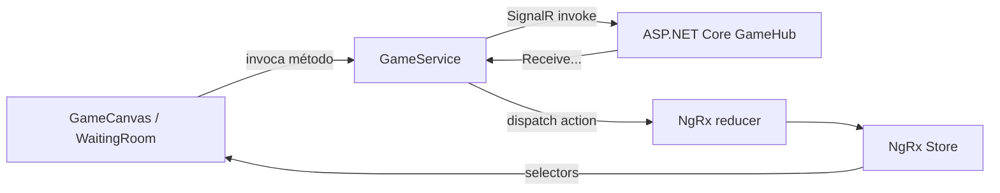

# Laboratório 05 — Atividade 2 — Erick

## Arquitetura encontrada

O frontend usa Angular 22, componentes standalone, RxJS e Vitest. Antes deste laboratório não havia NgRx instalado. Os arquivos locais `*.store.ts` usam signals para estado interno de mapa/tanque/explosão e foram preservados; o novo NgRx Store é restrito ao estado compartilhado multiplayer.

Dependências adicionadas:

- `@microsoft/signalr` 10.0.11;
- `@ngrx/store` 22.0.0-rc.0.

A versão RC do NgRx foi necessária porque o projeto já está em Angular 22 e a versão estável do NgRx disponível durante a implementação declara peer dependency para Angular 21.

## SignalR Service

`GameService` agora:

- cria uma única `HubConnection` para `http://localhost:5049/hubs/game`;
- fornece JWT por `accessTokenFactory`;
- usa reconexão automática com intervalos de 0, 2, 5 e 10 segundos;
- registra handlers uma única vez, quando a conexão é criada;
- volta a chamar `JoinRoom` depois de uma reconexão;
- envia movimento, chat e destruição do mapa;
- recebe jogadores, movimentos, chat/histórico e destruição do mapa;
- despacha os eventos recebidos no NgRx Store;
- expõe uma fábrica de conexão por `InjectionToken`, permitindo testes sem servidor real.

## NgRx

O estado `game` é registrado com `provideStore` em `app.config.ts`. Ele contém:

- estado/erro da conexão;
- ID do jogador local;
- lista e posições dos jogadores;
- histórico e última mensagem de chat;
- último movimento recebido;
- última alteração de mapa recebida.

Os arquivos estão em `src/app/core/store`:

- `game.actions.ts` descreve os eventos;
- `game.reducer.ts` faz transições imutáveis e evita mensagens duplicadas;
- `game.selectors.ts` expõe leituras memoizadas;
- specs validam reducer e selectors.

Effects não foram adicionados: os efeitos externos pertencem à conexão persistente do `GameService`, que traduz callbacks do SignalR em actions. Criar Effects apenas para reencaminhar esses callbacks adicionaria uma segunda camada sem benefício para esta arquitetura.

## Integração com UI e canvas

`WaitingRoom` seleciona status, erro, jogadores e mensagens diretamente do Store. `GameCanvas` seleciona jogadores, jogador local e alterações de mapa. Movimento local continua no signal store específico do tanque, pois animação por frame é estado local do componente; após a mudança, a posição é enviada ao serviço e registrada no estado multiplayer.



## Testes e build executados

```bash
npm test -- --watch=false
npm run build
```

Resultados reais em 10/08/2026:

- testes: 17 arquivos aprovados, 55 testes aprovados;
- build de produção: aprovado;
- bundle inicial: 282,35 kB bruto e 77,06 kB estimado transferido.

`game.service.spec.ts` usa uma conexão SignalR falsa e valida conexão única, entrada na sala, envio de eventos, recepção via Store e ausência de handlers duplicados após reconexão.

## Como executar

1. Iniciar o backend em `http://localhost:5049`.
2. Executar `npm start`.
3. Abrir `http://localhost:4200`.
4. Autenticar, criar/entrar em uma sala e abrir a sala de espera.

## Capturas necessárias

[CAPTURA DE TELA 1 — Angular conectado ao hub]

Mostrar a sala de espera com indicador “Conectado” e o Network do navegador exibindo a negociação/conexão em `/hubs/game`.

[CAPTURA DE TELA 2 — NgRx recebendo movimento]

Com Redux DevTools, mostrar a action `[Realtime Game] Player Moved` e o jogador com posição atualizada no estado `game`.

[CAPTURA DE TELA 3 — Chat atualizado pelo Store]

Mostrar duas janelas na mesma sala e a mesma mensagem confirmada pelo servidor nas duas listas de chat.

[CAPTURA DE TELA 4 — Testes e build Angular]

Mostrar os 55 testes aprovados e o build finalizado com sucesso.

## Referências oficiais

- [ASP.NET Core SignalR JavaScript client](https://learn.microsoft.com/en-us/aspnet/core/signalr/javascript-client?view=aspnetcore-8.0)
- [SignalR authentication and authorization](https://learn.microsoft.com/en-us/aspnet/core/signalr/authn-and-authz?view=aspnetcore-8.0)
- [Angular components](https://angular.dev/guide/components)
- [Angular build](https://angular.dev/tools/cli/build)
- [NgRx Store](https://ngrx.io/guide/store)
- [NgRx reducers](https://ngrx.io/guide/store/reducers)
- [NgRx selectors](https://ngrx.io/guide/store/selectors)
