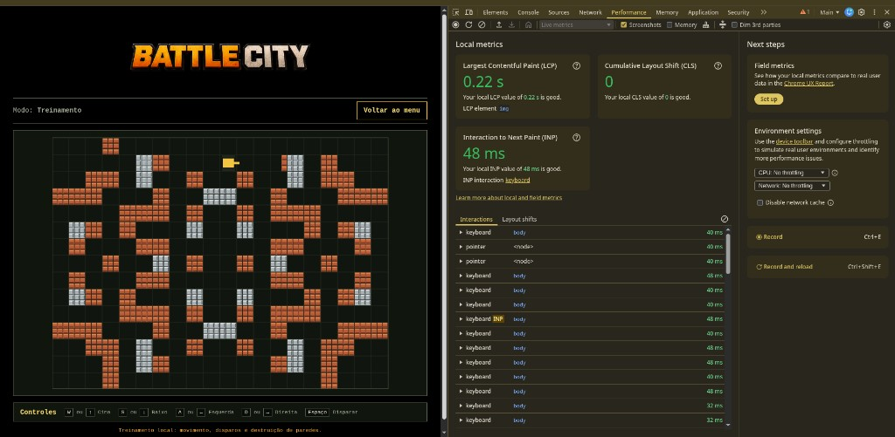
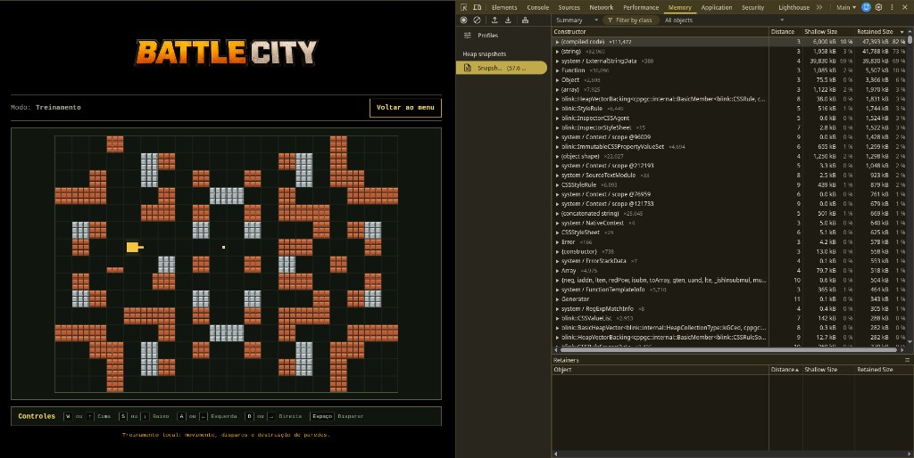
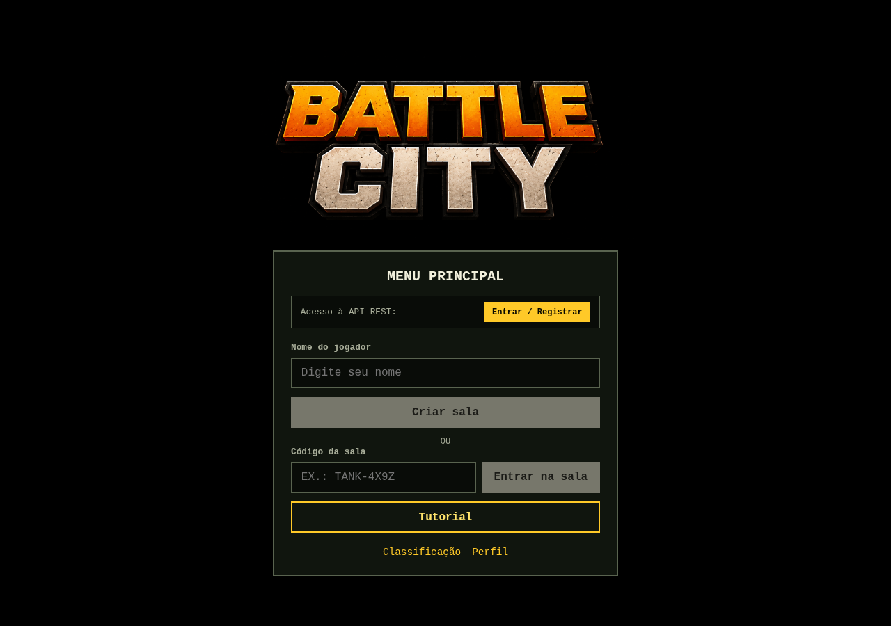
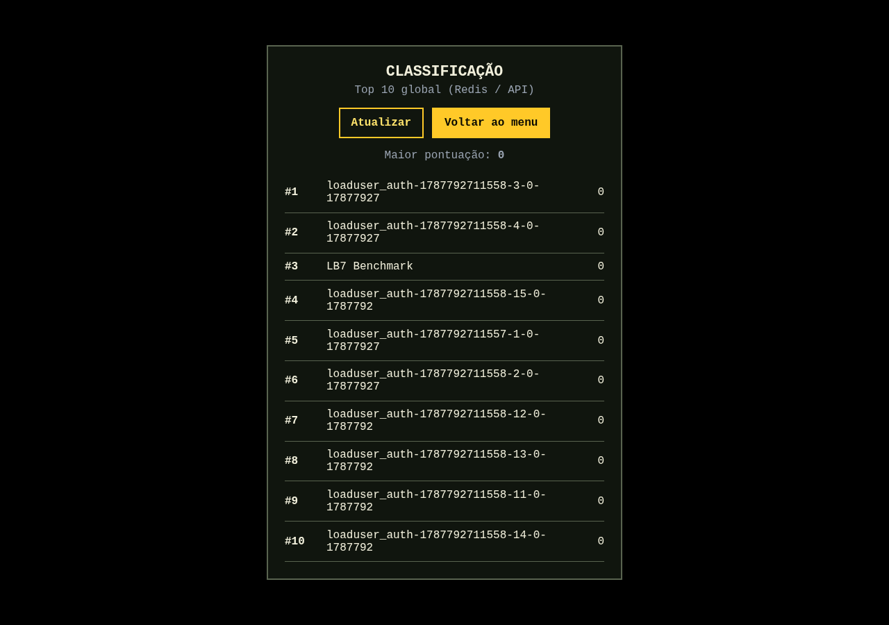
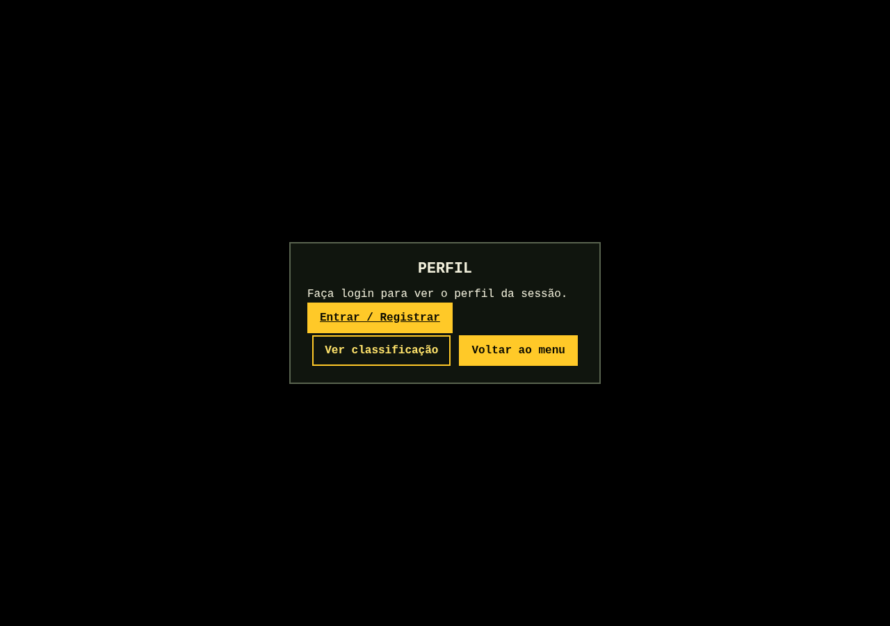
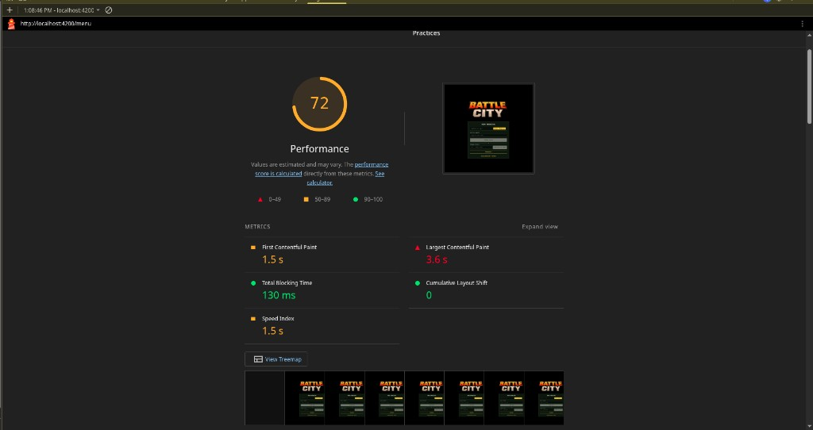
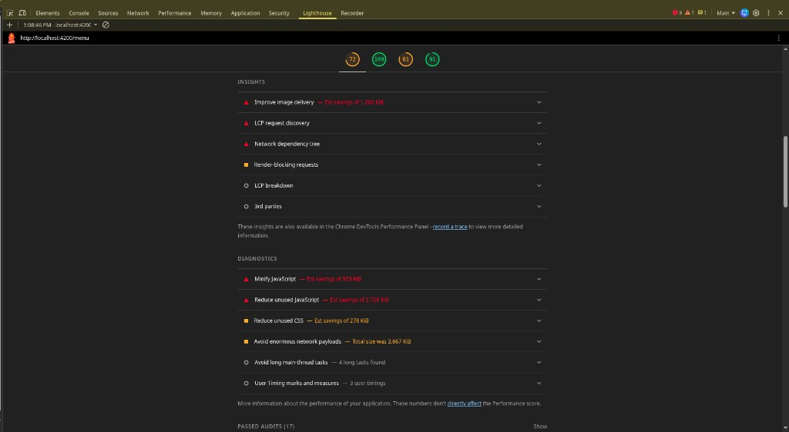
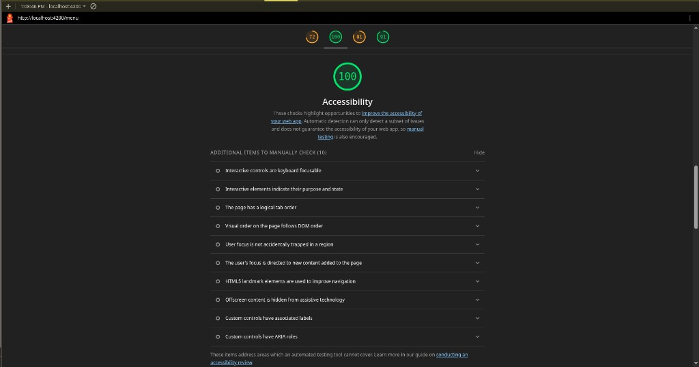
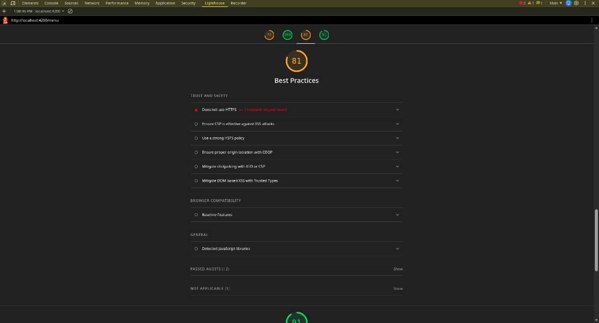
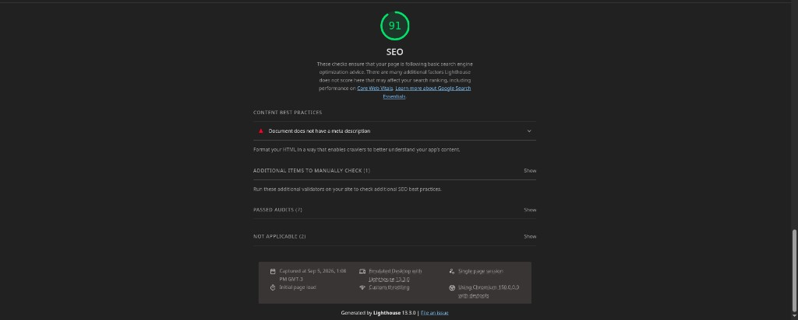

# Lab 09 — Activity #2 — Profiling do Frontend (Angular)

**Group:** Grupo 2  
**Branch:** `LB-9/frontend-profiling`  
**Stack:** Angular 22 · NgRx · Signal stores (`signal`/`computed`) · Chrome DevTools · Lighthouse

## Objetivo

Identificar gargalos de CPU/memória e re-render no frontend (canvas, teclado, SignalR/MQTT) e aplicar otimizações: **OnPush**, **`computed()`** nos stores de domínio, **lazy loading** de rotas (incluindo perfil e classificação) e baseline de **Lighthouse**.

---

## 1. Chrome DevTools — Memória e Desempenho

### Evidências (Chrome DevTools — captura manual)

Rota `/tutorial` com o jogo em **Modo: Treinamento**, DevTools aberto ao lado.

**Performance (Live metrics + Interactions)**



| Métrica | Valor | Leitura |
|---------|------:|---------|
| LCP | **0,22 s** | bom (green) |
| CLS | **0** | sem layout shift |
| INP | **48 ms** | interação de **teclado** (INP badge) |
| Interactions | vários `keyboard` no `body` | ~32–48 ms por tecla |

Isso cobre medição de **eventos de teclado** / responsividade durante movimento e disparo no canvas.

**Memory (Heap snapshot)**



| Item | Valor |
|------|------:|
| Snapshot 1 | **57,6 MB** |
| View | Summary · All objects |
| Maiores retained | `(compiled code)`, `(string)`, `system / ExternalStringData` |

Snapshot tirado com o tutorial ativo (canvas + mapa + controles). O heap inclui runtime Angular/V8 e assets da página; `ngOnDestroy` do canvas remove `keydown`, rAF e subscriptions ao sair da rota — próximo passo opcional é um 2º snapshot após Menu↔Tutorial para checar retenção.

### O que foi otimizado em código (impacto no profiling)

1. **Performance / CD:** `GameCanvas` com `OnPush` + `NgZone.runOutsideAngular` no rAF e teclado → menos change detection por frame/tecla.  
2. **Memory:** subscriptions e listeners limpos em `ngOnDestroy` (waiting-room / game / canvas).  
3. **Stores:** derivados via `computed()` para não recalcular à mão a cada read.

---

## 2. Otimização com `computed()` (Signal stores)

Não usamos `@ngrx/signals` SignalStore oficial; o projeto já tinha stores manuais com `signal()`. Ampliamos **`computed()`** para evitar recálculos ad hoc:

| Store | Novos / existentes |
|-------|--------------------|
| `TankSignalStore` | `tank`, `isActive`, **`isDestroyed`**, `healthPercentage`, **`healthLabel`** |
| `BattleMapSignalStore` | `tiles`, **`hasDestroyedParts`**, **`mapRevision`**, **`tileCount`** |
| `ExplosionSignalStore` | **`explosionCount`**, **`hasExplosions`**, **`destructiveExplosionCount`** |
| `Ranking` (feature) | `hasEntries`, `topScore` derivados de `signal` de entradas |

Ranking usa o mesmo padrão (signals + computed) na página de classificação.

---

## 3. OnPush e Lazy Loading

### ChangeDetectionStrategy.OnPush

Aplicado em componentes de alto tráfego / UI frequente:

- `GameCanvas` (+ `NgZone.runOutsideAngular` no rAF, resize e keydown)
- `Game` (com `markForCheck` nas subscriptions SignalR/MQTT)
- `WaitingRoom` (já usava `markForCheck`)
- `Menu`, `Auth`
- `Ranking`, `Profile` (novos)

### Lazy loading

Rotas de feature já usavam `loadComponent`. Incluímos as rotas pedidas pelo lab:

| Path | Chunk |
|------|--------|
| `/ranking` | `features/ranking/ranking` (classificação) |
| `/profile` | `features/profile/profile` |

Validação: Network tab no Chrome → navegar Menu → Classificação/Perfil → aparece JS lazy (não no bundle inicial do shell).

Evidência Playwright (Menu → Ranking carregou chunk + `GET /api/ranking/top`):







```text
Lazy/network hits after Menu→Ranking:
chunk-MI25I5J2.js
…/ranking.ts@Ranking
top?take=10
```

Atalhos no menu: links **Classificação** e **Perfil**.

---

## 4. Lighthouse — baseline e melhorias

### Evidência (Chrome DevTools → aba Lighthouse)

URL: `http://localhost:4200/menu` · Desktop · runtime Initial page load.











### Scores

| Categoria | Score |
|-----------|------:|
| Performance | **72** |
| Accessibility | **100** |
| Best Practices | **81** |
| SEO | **91** |

### Métricas de Performance

| Métrica | Valor | Faixa |
|---------|------:|-------|
| FCP | 1,5 s | moderado |
| LCP | 3,6 s | precisa melhorar |
| TBT | 130 ms | bom |
| CLS | 0 | bom |
| Speed Index | 1,5 s | moderado |

### Diagnósticos / oportunidades (do próprio Lighthouse)

| Achado | Estimativa / nota |
|--------|-------------------|
| Improve image delivery | ~1 280 KiB |
| Minify JavaScript | ~953 KiB *(esperado em `ng serve`)* |
| Reduce unused JavaScript | ~2 726 KiB |
| Reduce unused CSS | ~278 KiB |
| Payload total | ~3 667 KiB |
| Best Practices | sem HTTPS em localhost (esperado) |
| SEO | falta `meta description` |

### Propostas de melhoria

1. **Imagens:** comprimir / redimensionar o logo do menu (maior ganho no LCP).  
2. **Build prod:** `ng build --configuration=production` (minify + tree-shake) e re-rodar Lighthouse.  
3. **Lazy routes** ranking/profile (já feitas) — menos JS no first paint do menu.  
4. **OnPush + canvas fora da zone** — ajuda TBT / main-thread no jogo (já aplicado).  
5. **SEO:** adicionar `<meta name="description">` no `index.html`.  
6. HTTPS só importa fora de localhost.

---

## Arquivos principais alterados / criados

- `src/app/features/game/game-canvas/game-canvas.ts` — OnPush + outside Angular  
- `src/app/features/game/game.ts`, `waiting-room.ts`, `menu.ts`, `auth.ts` — OnPush  
- `src/app/features/game/*/…store.ts` — computed extras  
- `src/app/app.routes.ts` — lazy `/ranking`, `/profile`  
- `src/app/features/ranking/*`, `src/app/features/profile/*` — páginas novas  
- `src/app/core/services/ranking-api.service.ts`

---

## Conclusão

A Activity #2 endurece o frontend contra CD desnecessária no loop do jogo, memoiza derivados de estado via `computed()`, garante OnPush nas telas quentes e expõe **perfil** e **classificação** como chunks lazy — alinhado aos critérios de DevTools, SignalStore/`computed`, OnPush/lazy e Lighthouse.

## Referências

- [Angular change detection / OnPush](https://angular.dev/best-practices/skipping-subtrees)  
- [Angular signals / computed](https://angular.dev/guide/signals)  
- [Chrome Performance panel](https://developer.chrome.com/docs/devtools/performance)  
- [Lighthouse](https://developer.chrome.com/docs/lighthouse/overview)
